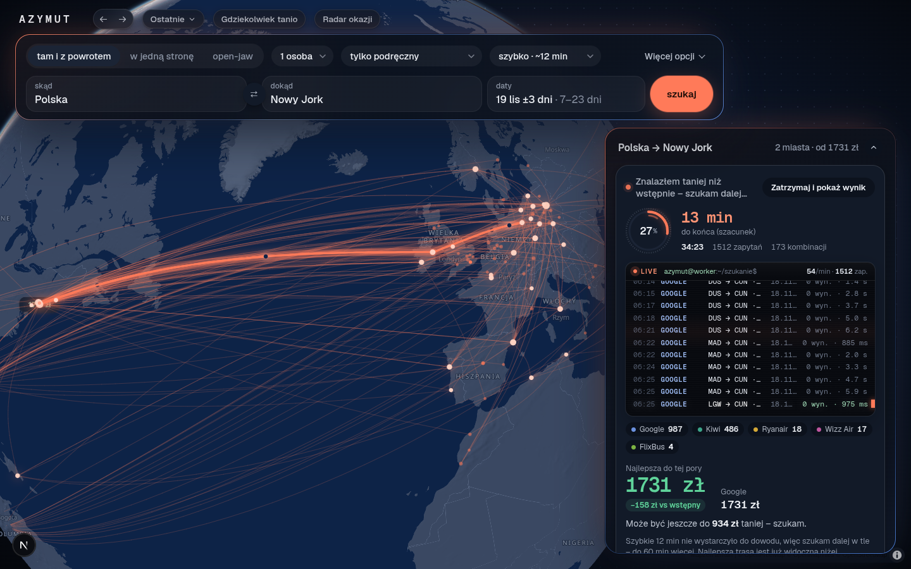
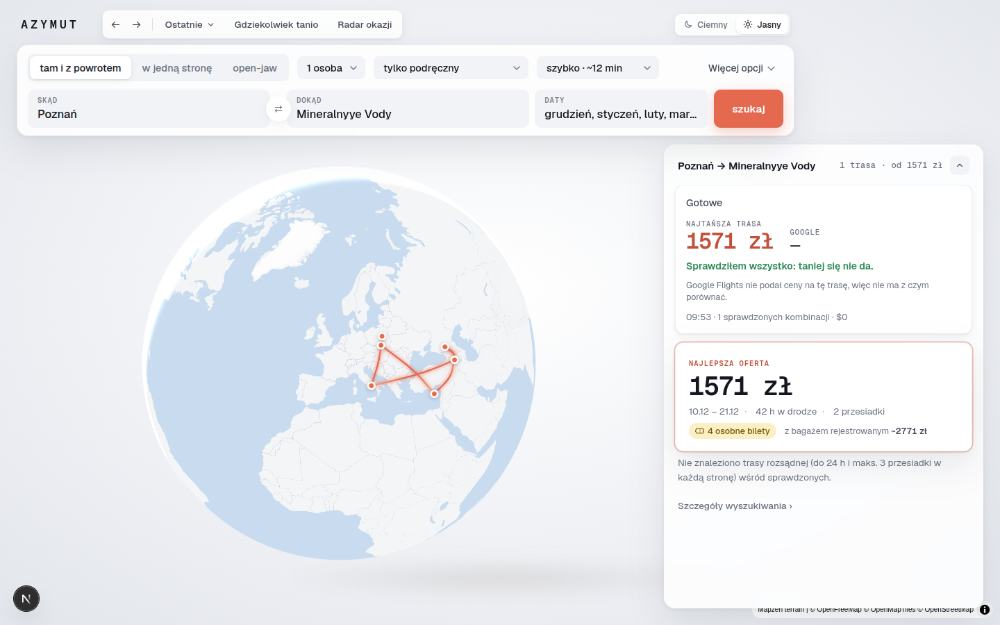

# Azymut

**English** · [Polski](README.pl.md)

**A flight search engine that builds the cheapest trips out of separate tickets.** It searches the
way a stubborn person with ten browser tabs would: low-cost hops to a big hub, a return ticket from
another city, a stopover with a night in between, a bus to an airport across the border. Free data
sources only, running on your own computer. The interface is in English and Polish.



## Install (5 minutes)

You need [Node.js](https://nodejs.org) 20 or newer and git.

```bash
git clone https://github.com/jacekstankiewicz1602-debug/azymut-flights.git
cd azymut-flights
npm install
npm run local
```

Open **http://localhost:3000**. No accounts, keys or passwords.

`npm run local` starts three things at once:

- **a database:** a real Postgres from an npm package (no Docker), data in `.azymut/`;
- **the site:** Next.js on port 3000;
- **the worker:** the search engine, running in the background, so you can close the tab and come
  back for the result.

On the first run the bundled price map (`data/map-snapshot.json.gz`, about 27,000 connections) is
loaded into the database; it refreshes itself on start when it is more than a day old (a few minutes
in the background). Ctrl+C stops everything. Another port: `PORT=3100 npm run local`.

## What it does

- **Separate tickets:** combines flights of different airlines and bookings, with time for the
  connection, a night's stay and the transfer between airports.
- **Return tickets from hubs:** e.g. Budapest ⇄ Bangkok plus a separate flight to Budapest, often
  far cheaper than one ticket from home.
- **Proof of optimality:** branch and bound over a map of lower price bounds; the result says "checked
  everything, it doesn't get cheaper" or how much cheaper it still could be (the gap).
- **Modes:** quick (~12 min, and if a gap is left it keeps going in the background), research ~1 h,
  until proven.
- **Anywhere:** the cheapest destinations in the world from your city.
- **Russia and far-off places:** flights via Yerevan, Istanbul, Dubai (Aviasales), far hubs
  (Singapore, Bangkok, Doha…).
- **Baggage:** cabin bag only or with a checked bag, with each airline's fees.
- **On the phone:** the site installs like an app and sends a notification when a search is done.

Defaults (home city Poznań, departures from Poland plus Berlin, Prague and Budapest) are tuned for
Poland; type any city or country in "from".



## Data sources

All free, through the sites' public endpoints:

| Source | Used for |
|---|---|
| Google Flights | prices for given days, date grids, the baseline price to compare with |
| Kiwi.com | long legs over the whole date window, ready-made separate-ticket combinations |
| Ryanair, Wizz Air | price calendars and route maps |
| Aviasales | price calendars, incl. flights to and from Russia |
| Kayak | the "anywhere" price map |
| FlixBus | bus transfers with real times and prices |

Optional (off by default, see `.env.example`): SerpAPI, Duffel, Claude (reading place names in
sentences).

> Azymut is not affiliated with any of these companies. It uses their public pages the way a browser
> does, with rate limits and a response cache. Use it privately and in moderation. Prices are as of
> the moment of the query: always check them with the airline before buying.

## Your own server (optional)

How the version for friends runs: the site on Vercel, the database on Neon (free plans), the worker on
a laptop.

1. Import the repo in Vercel and connect a Neon database (Marketplace). Set `APP_PASSWORD` (the
   site's password) and `CRON_SECRET` (any random string).
2. On the computer that should search: `.env.local` with `DATABASE_URL` (from Neon), `CRON_SECRET`
   and `APP_URL` (the site's address), then `npm run worker`, or `./worker/install.sh` to start it
   automatically (systemd, Linux). Details in [worker/README.md](worker/README.md).
3. The price map can refresh itself through GitHub Actions (`.github/workflows/map.yml`): set the
   repository variable `AZYMUT_MAP=1` and the secret `DATABASE_URL`.

Without a running worker, quick searches run on Vercel in steps of about 2 minutes.

## How it works

- `lib/engine.ts`: the engine. Kiwi's ready-made combinations as the first reference, then return
  tickets from hubs and branch and bound over the lower-bound map (separate queues out and back; bulk
  queries tighten many bounds at once). Scheduling is dynamic programming over real flights and bus
  runs (at least 3 h per connection, 5 h when changing airports).
- `lib/live.ts`: resumable searches. Source answers are stored with the search, so each next step
  replays earlier work in seconds and goes further.
- `lib/sources/`: source clients with rate limits, caching and retries.
- `scripts/worker.ts`: the worker, `scripts/local.ts`: local mode, `scripts/map-worker.ts`: the price map.
- `components/`: the interface (Next.js, React), the globe on MapLibre GL (OpenFreeMap, no key).

```bash
npm run typecheck
npx tsx scripts/test-engine.ts "Poznań → Lima, luty 2027, 14–21 dni"
```

## License

MIT, see [LICENSE](LICENSE).
