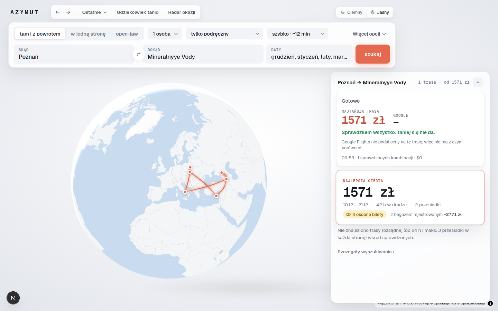

# Azymut

[English](README.md) · **Polski**

**Wyszukiwarka najtańszych lotów, która składa trasy z osobnych biletów.** Szuka tak, jak zrobiłby to
uparty człowiek z dziesięcioma kartami w przeglądarce: tanie linie do dużego hubu, bilet powrotny z
innego miasta, przesiadka z noclegiem, autobus na lotnisko za granicą. Wszystko na darmowych źródłach,
na Twoim komputerze. Interfejs po polsku i angielsku.


## Instalacja (5 minut)

Potrzebujesz [Node.js](https://nodejs.org) 20 lub nowszego i gita.

```bash
git clone https://github.com/jacekstankiewicz1602-debug/azymut-flights.git
cd azymut-flights
npm install
npm run local
```

Otwórz **http://localhost:3000**. Bez kont, kluczy i haseł.

`npm run local` uruchamia trzy rzeczy naraz:

- **bazę danych:** prawdziwy Postgres z paczki npm (bez Dockera), dane w folderze `.azymut/`;
- **stronę:** Next.js na porcie 3000;
- **workera:** silnik szukania, który pracuje w tle, więc możesz zamknąć kartę i wrócić po wynik.

Przy pierwszym uruchomieniu do bazy trafia dołączona mapa cen (`data/map-snapshot.json.gz`, ok. 27
tys. połączeń). Ctrl+C zatrzymuje wszystko.

Mapa cen odświeża się sama przy starcie, jeśli ma więcej niż dobę (kilka minut w tle). Inny port:
`PORT=3100 npm run local`.

## Co potrafi

- **Osobne bilety:** łączy loty różnych linii i biletów, liczy czas na przesiadkę, nocleg i dojazd
  między lotniskami.
- **Bilety powrotne w hubach:** np. Budapeszt ⇄ Bangkok i osobno dolot do Budapesztu, często dużo
  taniej niż jeden bilet z Polski.
- **Dowód optymalności:** branch and bound na mapie dolnych granic cen; wynik „sprawdziłem wszystko,
  taniej się nie da” albo luka, ile jeszcze mogłoby być taniej.
- **Tryby:** szybki (~12 min, a gdy zostaje luka, szuka dalej w tle), research ~1 h, do skutku.
- **Gdziekolwiek:** najtańsze kierunki na świecie z wybranego miasta.
- **Rosja i egzotyka:** loty przez Erywań, Stambuł, Dubaj (Aviasales), dalekie huby (Singapur,
  Bangkok, Doha…).
- **Bagaż:** tylko podręczny albo z rejestrowanym, z opłatami każdej linii.
- **Na telefonie:** strona instaluje się jak aplikacja i wysyła powiadomienie, gdy szukanie się skończy.



## Źródła danych

Wszystkie bezpłatne, przez publiczne endpointy stron:

| Źródło | Do czego |
|---|---|
| Google Flights | ceny na konkretne dni, siatki dat, cena bazowa do porównania |
| Kiwi.com | długie odcinki na całe okno dat, gotowe kombinacje z osobnych biletów |
| Ryanair, Wizz Air | kalendarze cen i mapa tras |
| Aviasales | kalendarze cen, m.in. loty do i z Rosji |
| Kayak | mapa cen „gdziekolwiek” |
| FlixBus | dojazdy autobusem z prawdziwymi godzinami i cenami |

Opcjonalnie (domyślnie wyłączone, patrz `.env.example`): SerpAPI, Duffel, Claude (rozpoznawanie
nazw miejsc w zdaniach).

> Azymut nie jest powiązany z żadną z tych firm. Korzysta z publicznych stron tak jak przeglądarka,
> z limitami zapytań i pamięcią odpowiedzi. Używaj go prywatnie i z umiarem. Ceny to stan z chwili
> zapytania: przed zakupem zawsze sprawdź je u przewoźnika.

## Własny serwer (opcjonalnie)

Tak działa wersja dla znajomych: strona na Vercel, baza w Neon (darmowe plany), worker na laptopie.

1. Zaimportuj repo w Vercel i podłącz bazę Neon (Marketplace). Ustaw zmienne:
   `APP_PASSWORD` (hasło do strony), `CRON_SECRET` (dowolny losowy ciąg).
2. Na komputerze, który ma szukać: `.env.local` z `DATABASE_URL` (z Neon), `CRON_SECRET` i
   `APP_URL` (adres strony), potem `npm run worker` albo `./worker/install.sh`, żeby startował sam
   (systemd, Linux). Szczegóły w [worker/README.md](worker/README.md).
3. Mapa cen może odświeżać się sama przez GitHub Actions (`.github/workflows/map.yml`): ustaw
   zmienną repozytorium `AZYMUT_MAP=1` i sekret `DATABASE_URL`.

Bez działającego workera szybkie szukania idą na Vercel w krokach po ~2 minuty.

## Jak to działa

- `lib/engine.ts`: silnik. Gotowe kombinacje Kiwi jako pierwszy punkt odniesienia, potem bilety
  powrotne w hubach i branch and bound na mapie dolnych granic (osobne kolejki tam i powrót,
  zapytania zbiorcze zaostrzają wiele granic naraz). Harmonogram to programowanie dynamiczne po
  konkretnych lotach i kursach autobusów (min. 3 h przesiadki, 5 h przy zmianie lotniska).
- `lib/live.ts`: wyszukiwanie wznawialne. Odpowiedzi źródeł są zapisywane przy wyszukiwaniu, więc
  każdy kolejny krok odtwarza wcześniejszą pracę w sekundy i idzie dalej.
- `lib/sources/`: klienci źródeł z limitami, pamięcią i ponawianiem.
- `scripts/worker.ts`: worker, `scripts/local.ts`: tryb lokalny, `scripts/map-worker.ts`: mapa cen.
- `components/`: interfejs (Next.js, React), kula na MapLibre GL (OpenFreeMap, bez klucza).

```bash
npm run typecheck
npx tsx scripts/test-engine.ts "Poznań → Lima, luty 2027, 14–21 dni"
```

## Licencja

MIT, patrz [LICENSE](LICENSE).
